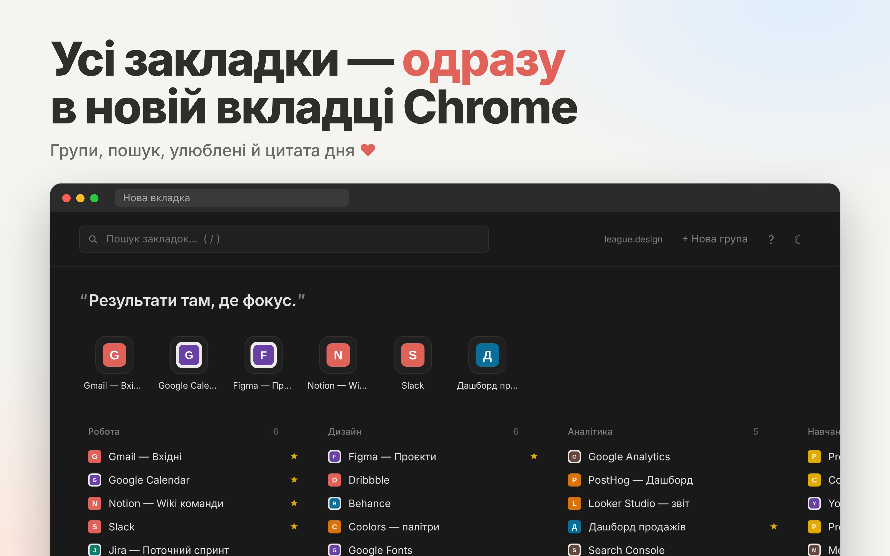

# Work-Love-Balance ♥ — закладки в новій вкладці Chrome

**[⬇ Встановити з Chrome Web Store](https://chromewebstore.google.com/detail/jpgnhdhgiogedcdalebnijpemhehkped)** · [Сайт](https://landing-production-80543e03.up.railway.app)

Розширення, яке замінює нову вкладку Chrome на зручну дошку з усіма вашими закладками — у стилі Notion, зі світлою й темною темою.

## Що вміє

- 🗂 **Групи-стовпчики** — кожна папка закладок стає стовпчиком. Створюйте, перейменовуйте, міняйте порядок перетягуванням.
- 🔍 **Миттєвий пошук** — за назвою й адресою. `/` — фокус, `↑↓` — вибір, `Enter` — відкрити.
- ★ **Улюблені** — рядок великих плиток для того, що відкриваєте щодня.
- ✋ **Drag & drop** — перетягуйте закладки між групами, в улюблені, в архів або в кошик (з кнопкою «Повернути»).
- 🔴 **Не розібрані** — нові закладки чекають в окремому стовпчику, поки ви їх не розкладете.
- 🗄 **Архів** — згорнута колонка для того, що шкода видаляти.
- ❝ **Цитата дня** — власна бібліотека мотиваційних цитат, одна на день.
- ◐ **Тема** — світла, темна або як у системі.

Усе зберігається у ваших звичайних закладках Chrome — нічого не відправляється в інтернет.

## Встановлення

1. **[⬇ Завантажте розширення (ZIP)](https://github.com/samomisha/bookmarks-newtab/releases/latest/download/bookmarks-newtab-1.6.1.zip)** і розпакуйте в постійну папку, не в «Завантаження».
2. Відкрийте `chrome://extensions` і ввімкніть **Режим розробника** (праворуч угорі).
3. Натисніть **Завантажити розпаковане** і виберіть папку.
4. Якщо у вас стоїть інше розширення нової вкладки — вимкніть його.
5. Відкрийте нову вкладку. Якщо Chrome спитає про зміни — **Залишити**.

**Оновлення:** замініть файли в папці й натисніть ↻ на картці розширення.

## Ліцензія

MIT · Зроблено в [League Design](https://league.design)
